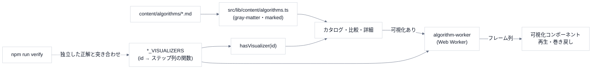

# 1. 全体像

## データの流れ

## ページ

| パス | 内容 |
|---|---|
| `/` | カタログ(検索・カテゴリ絞り込み・入口) |
| `/algorithms/[id]` | 詳細: 説明・可視化・擬似コード・実装例(5 言語)・関連 |
| `/compare` | 最大 4 件の比較(可視化あれば並べて実行) |
| `/atlas` | 年表(時間軸 / 分野の輪) |
| `/map` | 依存の地図(記事本文のリンクから読み取ったつながり) |
| `/updates`・`/api/updates` | 更新情報(外部 RSS を Edge Function で中継) |
| `/basics`・`/about` | 入門・About |

## データの置き場所

| もの | 場所 |
|---|---|
| 記事 | `content/algorithms/<id>.md`(frontmatter は `name`・`category`・`subcategory`・`complexity`・`summary` の 5 項目) |
| 年表 | `content/atlas/milestones.json`(各項目に出典と「生まれた目的」が必須) |
| お気に入り・最近見た | localStorage(`use-favorites`・`recently-viewed`) |
| サーバー・DB | **無い**(Vercel の静的生成 + 更新情報の Edge Function だけ) |

## コマンド

| コマンド | 役割 |
|---|---|
| `npm run dev` / `build` / `start` / `lint` | 開発・ビルド |
| `npm run verify` | 可視化の正しさの検証(1508 件) |
| `npm run verify:categories` | 全記事の分類が `CATEGORY_TAXONOMY` と一致するか |
| `npm run stats:categories` | カテゴリ別の収録数・可視化対応数(README の表の元) |
| `npx tsc --noEmit` | 型検査だけ |

**この Next.js は従来と異なる点がある**ので、コードを書く前に `node_modules/next/dist/docs/` を確認する(`AGENTS.md`)。

## やらないこと(範囲の外)

- **速さを競うランキング**(目的は「なぜ生まれ、どう動き、どこで報われるか」を学ぶこと)。
- **任意の入力を受け付ける可視化**(入力は固定のデモ。前提は第 5 回)。
- 状態のキャッシュ(IndexedDB)・状態の差分記録は未実装。
